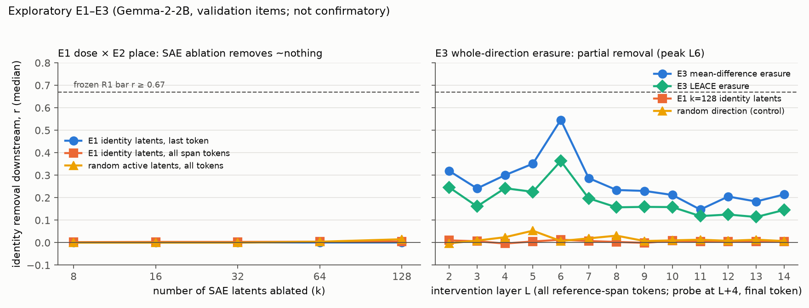
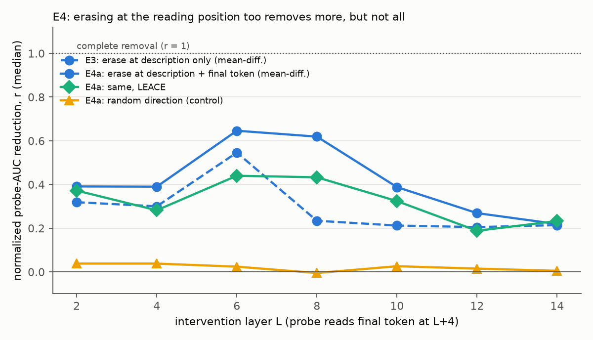

# AlignedLab — Experiment 3: The Kantian Positional Logic Test

**Is an object's identity a condition of possibility for predicting what happens to it? A gated, pre-frozen test in Gemma-2-2B**

**Principal investigator:** Dr. Ali A. Di Fenza (AlignedLab, Berlin)  
**Research collaborators:** Qualam (GPT-6: research director, methodology, internal audit), Claude (lead engineer: code, data, analysis, report draft), Gemini and DeepSeek (independent AI reviewers of the results; Grok was planned but unavailable). The PI retained scientific authority and interpretation.  
**Context:** Mechanistic Interpretability Hackathon #5 (Apart Research), November 2026. AlignedLab Experiment 3 = Research Agenda Chapter 2, Experiment 2.  
**Status — November 21, 2026:** Frozen verification complete, **no valid layer; P2 and P3 inconclusive**. Evaluation set sealed and never opened. Exploratory follow-ups E1–E4 complete and independently reviewed.

## Why this experiment exists

AlignedLab's goal is to find new research paths by applying philosophical concepts to machine learning: to make an idea testable, test it, and gather first evidence toward new and more radical ways of understanding and aligning AI. This experiment comes from the PI's research agenda, *Aligning Latent Spaces: From Possibility to Power*. Its seed was purely Kantian: **a relational circuit (Causality) cannot function without drawing from an upstream entity circuit (Substance).** Protocol V1.1 widened the frame to ask whether **Plato's Forms and Kant's conditions of possibility** can explain and predict how a network's representations and downstream circuits are organized. A Form, as used here, is the structure that lets many different descriptions count as *the same kind of thing*, and V1.1 allowed it to be "a multidimensional, distributed structure."

The question is a starting point, **not an established finding**. The point is to move from philosophical conjecture to a falsifiable test without declaring the conjecture true.

## Design and frozen scientific authority

The authoritative specification is **Protocol V1.1** ([protocol/experimental_protocol_v1.1.md](protocol/experimental_protocol_v1.1.md)) together with the **G5 spec freeze** and Amendment 1 ([protocol/G5_SPEC_FREEZE.md](protocol/G5_SPEC_FREEZE.md); frozen 2026-11-21 18:32 CET). It must not be silently rewritten to match later interpretations.

- **Model:** `google/gemma-2-2b` @ `c5ebcd40d208330abc697524c919956e692655cf`; fp32, eager attention, deterministic, Modal A10G. SAEs: Gemma Scope residual, width 16k, L0 ≈ 70 per layer.
- **Data:** nine object kinds in three families (impact: raw hen's egg, aluminum beverage can, car windshield, the confirmatory family; heating; cutting) with property-matched look-alikes, noun-free descriptions, several grammatical roles, and one fixed bystander per family. Splits: discovery v1.2 (492), validation v1.1 (492), **evaluation v1.1 (1,152; sealed)**. See [datasets/kantian_v1/DATASET_CARD.md](datasets/kantian_v1/DATASET_CARD.md).
- **Predictions:** **P1** identity representation exists (invariant across descriptions and roles); **P2** removing it lowers the correct causal outcome's log-odds more than both controls (C1 unrelated features, C2 bystander noun); **P3** the dependency runs through a specific pathway.
- **Frozen gate:** a layer is valid only if the chosen ≤ 8 SAE features (R1) remove ≥ 67% of downstream identity, (R2) pass the identity criteria, (R3) admit valid controls, and (P3) have a downstream head. **No valid layer ⇒ P2/P3 inconclusive; nothing re-tuned.**

## What we found

| Test or finding | Observed result | Interpretation |
|---|---|---|
| **Identity decodable (P1, partial)** | Probe AUC 0.93–1.0 at the object's last word, layers 2–14 | Information is **available**; strict P1 criteria passed only sporadically (14 of 117 kind × layer cases) |
| **R1 efficacy (frozen)** | 0 of 156 layer × kind cases; normalized downstream probe-AUC reduction r ≈ 0.00 | The chosen SAE features cannot remove identity |
| **P2 / P3 (primary)** | Not run: no valid layer | **Inconclusive by the frozen rule**; evaluation set sealed |
| **E1 dose / E2 place** (exploratory) | Up to 128 SAE features, one or all description words: median r ≤ 0.005; random features ≈ 0 | Not a matter of how many selected SAE features, or where in the description |
| **E3 whole direction** (exploratory) | Linear erasure incl. SAE error: median r 0.26 (mean-diff.) / 0.18 (LEACE); random 0.01 | Modest, specific partial removal |
| **E4 already traveled?** (exploratory) | Identity already readable at the final token before intervening (AUC 0.71–0.92); erasing there too: r 0.22–0.65 (mean-diff.) four layers later | Travel explains part, not all; no collapse |
| **Exploratory causal comparison** | 3–5 items, effects ≤ 0.1 log-odds | No conclusion possible |

**Headline:** *Substance remains decodable but not causally isolable at the tested intervention site; P2/P3 inconclusive.* The Kantian dependency itself remains **untested**. For AI safety, the practical lesson is that **decodability is not removability**: interventions built on decoded SAE features must be verified downstream, where the information is used.

The PI's working conception of identity, "organized togetherness; no single part essential," is **not** a finding of this study. It motivates three predictions for V2: several distinct directions each carry part of identity; erasing some leaves downstream decoding intact; erasing all of them at the reading position makes it collapse.




## The AlignedLab Research Spiral

1. **Philosophical direction — Ali:** concepts, questions, hypotheses, approvals, spending, and scientific authority; launched every model run.
2. **Conceptual translation — Ali + Qualam (GPT-6):** protocol, predictions, measurements, controls, falsification criteria.
3. **Technical translation and execution — Claude:** feasibility, code, tests, data repair and generation, analysis, figures, report draft.
4. **Criticism — Gemini and DeepSeek (independent), Qualam (internal audit); interpretation — Ali.**

These are roles **within one research case**, not evidence that this arrangement beats other teams. Observed costs: cross-model handoffs, no engineer access to the PI's machine (every run was a pasted command), reviewer availability, and a dataset that consumed most of a day. The full record of what went wrong is in the report, Appendix B.

## Repository and evidence

- [protocol/](protocol/) — Protocol V1.1 (approved), fidelity record, V1.2 consolidated reissue, **G5 spec freeze**.
- [datasets/kantian_v1/](datasets/kantian_v1/) — all splits with checksums, generation and audit scripts, dataset card.
- [g4_probe/](g4_probe/) — G4 feasibility probe (exploratory).
- [g5_verification/](g5_verification/) — G5v verification, C2 bug record, repair spec, **G5r frozen verification** (`g5r_probe.py`, results, merge, tests).
- [exploratory/](exploratory/) — E1–E3 (`e_probe.py`) and E4 (`e4_probe.py`), local tests, analysis scripts, raw results, summaries, figures.
- [review/](review/) — review packages (v1, v2), Gemini, DeepSeek and Qualam reviews verbatim, consolidation, plain-English explainer.
- [report/](report/) — submission report (Word) and its build script.
- [STATUS.md](STATUS.md) — live record of every PI decision, run, cost and result.

## Reproduce

```bash
# Local plumbing tests (CPU, tiny random model; say nothing about the real model)
python3 g5_verification/test_g5r_dataset_local.py
python3 exploratory/test_e_local.py
python3 exploratory/test_e4_local.py

# Real-model runs (Modal; needs a Hugging Face token as Modal secret "huggingface-secret")
# Run folder must contain the script, g4_probe.py (and e_probe.py for E4) and g5r_input.jsonl
MODAL_IMAGE_BUILDER_VERSION=2025.06 python3 -m modal run g5r_probe.py --data g5r_input.jsonl --layers 2,3,4,5,6,7,8,9,10
MODAL_IMAGE_BUILDER_VERSION=2025.06 python3 -m modal run e_probe.py  --data g5r_input.jsonl --layers 2,3,4,5,6,7,8
MODAL_IMAGE_BUILDER_VERSION=2025.06 python3 -m modal run e4_probe.py --data g5r_input.jsonl

# Analysis from the committed raw results (no GPU)
cd exploratory && python3 e_analyze.py results/e_results_layers_*.json && python3 e4_analyze.py results/e4_results.json results/e_results_layers_*.json
```

Pinned stack: torch 2.5.1, transformers 4.46.3, tokenizers 0.20.3, huggingface-hub 0.26.5, numpy 1.26.4. Total compute for the whole project: **≈ $2.21** (cap $30).

## Scientific integrity and AI disclosure

The PI conceived the research and approved every substantive scientific choice and every expense. Claude implemented and tested all code, generated the validation and evaluation data, ran the analyses and drafted the report; the PI launched every run and is responsible for the conclusions. Qualam audited the results and is **not** independent; Gemini and DeepSeek reviewed independently. No AI critique is presented as human peer review. Exploratory analyses (E1–E4) were run after the frozen result and never feed P2/P3. Validation and evaluation data were AI-authored from templates, a disclosed limitation. Neither the experiment nor its results establish or refute Kant's or Plato's claims.

**Citation:** Di Fenza, A. A. (2026). *Decodable but Not Isolable: Testing Whether an Object's Identity Is a Condition of Possibility for Causal Prediction in Gemma-2-2B.* AlignedLab, Berlin.
